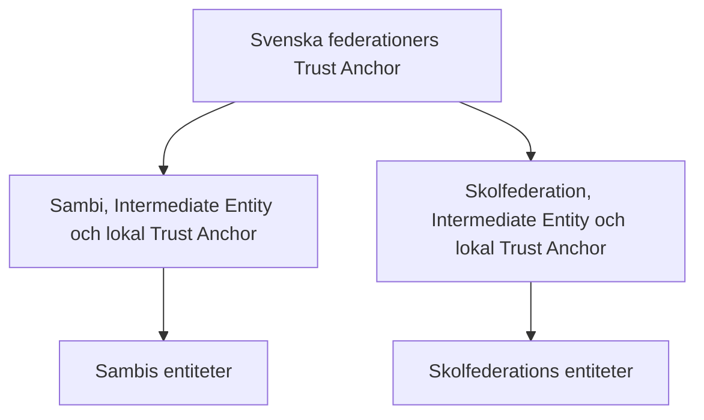
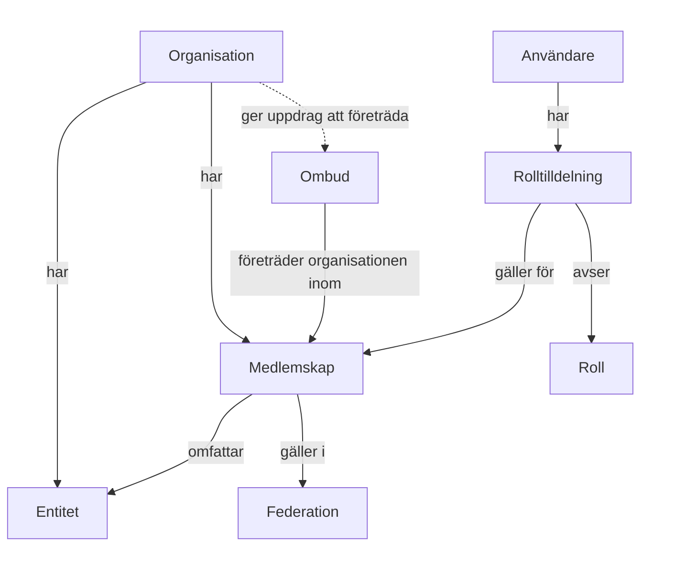

# Preliminär OIDF-arkitektur för Svenska federationer

**Arbetsdokument**  
**Internetstiftelsen**  
**Version 0.4**  
**Datum: 2026-10-26**

## 1. Syfte och status

Dokumentet beskriver en preliminär logisk OIDF-arkitektur för Svenska federationer. Utgångspunkten är att organisationer har entiteter i federationerna genom sina medlemskap. Arkitekturen bygger på den konceptuella modellen för auktoritativ information, verksamhetsfallen, de arkitekturella kraven och mappningen till OpenID Federation 1.1.

Arkitekturen ska tydliggöra:

- vilka administrativa och tekniska komponenter som behövs,
- hur organisationer, medlemskap och entiteter hålls samman,
- hur ansvar fördelas mellan Svenska federationer, federationerna, organisationerna och utförarna,
- hur organisatoriska Trust Marks kan utfärdas och hanteras i stor skala,
- hur teknisk tillit kan etableras inom och mellan federationerna.

Dokumentet beskriver ännu inte en normerande teknisk profil. Exakta protokollgränssnitt, metadatafält, algoritmer, Metadata Policies och protokollflöden specificeras i ett senare skede.

Innehållet skiljer mellan fastställda principer, arbetsantaganden och frågor som återstår. Ett arbetsantagande är en lösning som används för att göra arkitekturen sammanhängande men som ännu inte är beslutad.

## 2. Terminologi

Termer från OpenID Federation 1.1 används med den betydelse som anges i specifikationen. Nedan definieras endast begrepp som är specifika för denna arkitektur eller används med en särskild betydelse.

**Organisation**  
Det gemensamma administrativa objekt som kan ha medlemskap och entiteter i en eller flera federationer.

**Medlemskap**  
En federationsspecifik relation mellan en organisation och en federation. Medlemskapet har en egen status och giltighet samt egna regler och administrativa underlag. Att en organisation är medlem betyder att den har ett giltigt medlemskap i den aktuella federationen.

**Medlemsregistrerad Intermediate Entity**  
En Intermediate Entity som är registrerad för en organisations medlemskap och har ett giltigt organisatoriskt Trust Mark som intygar vilken organisation den representerar. Den kan registrera underordnade entiteter för samma organisation.

**Intermediate Entity för ombud**  
En Intermediate Entity som är registrerad för ett ombud och kan ha underordnade entiteter för flera organisationer. Den har inget organisatoriskt Trust Mark och behandlas därför inte som en medlemsregistrerad Intermediate Entity vid enrolment av underordnade entiteter.

**Användare**  
En person som genom tilldelade roller får utföra administrativa handlingar för en organisations räkning. Rolltilldelningen anger rollen och vilket medlemskap den gäller för.

**Huvudkontakt**  
En roll för en användare som får tilldela rollen teknisk kontakt för ett bestämt medlemskap.

**Teknisk kontakt**  
En roll för en användare som får administrera entiteter och registrera tekniska agenter för ett bestämt medlemskap.

**Teknisk agent**  
En roll för en användare som får administrera entiteter för ett bestämt medlemskap.

**Leverantör**  
En organisation som på uppdrag tillhandahåller administrativa eller tekniska tjänster åt en annan organisation.

**Ombud**  
En organisation som är godkänd av federationen för att företräda en eller flera organisationer vid anslutning och löpande administration.

Ombudet agerar på uppdrag av den organisation det företräder. Medlemskapet i federationen tillhör alltid den företrädda organisationen. Federationen fastställer villkoren för ombudets godkännande, uppgifter, befogenheter och ansvar.

## 3. Grundprinciper

- Organisationen är det centrala administrativa objektet och har entiteter i federationen genom sitt medlemskap.
- En organisation kan ha separata medlemskap i flera federationer.
- Medlemskap, roller och behörigheter avgränsas per federation.
- Kopplingen mellan en entitet, organisationen och medlemskapet fastställs utifrån federationens auktoritativa administrativa information. Det mottagande systemet beslutar om åtkomst.
- Det administrativa systemet hanterar roller, behörigheter, utförare och spårbarhet.
- Svenska federationer fastställer den gemensamma profilen för organisatoriska Trust Marks.
- Varje federation ansvarar för sina medlemsbeslut och den administrativa information som ligger till grund för utfärdandet av organisatoriska Trust Marks.
- Varje federation ansvarar för sina Trust Mark Issuers och för att rätt Trust Mark Issuers är registrerade hos Svenska federationers Trust Anchor.
- Inom en federation etableras tillit till Trust Mark Issuers mot federationens lokala Trust Anchor. Svenska federationers gemensamma Trust Anchor används när tillit behöver etableras mellan federationer.

## 4. Övergripande arkitektur

### 4.1 Övergripande topologi

Topologin nedan är ett arbetsantagande.



Varje federation representeras tekniskt av en entitet som:

- är en Intermediate Entity under Svenska federationers gemensamma Trust Anchor,
- fungerar som Trust Anchor för den egna federationens entiteter,
- utfärdar Subordinate Statements för sina direkt underordnade entiteter, inklusive eventuella Intermediate Entities,
- tillämpar federationens tekniska regler på sina underordnade entiteter.

Svenska federationers Trust Anchor ansluter de ingående federationerna till en gemensam teknisk rot. Topologin möjliggör resolution och validering över federationsgränser utan parallell registrering i flera federationer.

### 4.2 Grundläggande ansvarsfördelning

| Part | Ansvar |
|---|---|
| Svenska federationer | Gemensam teknisk rot, gemensamma tekniska krav och begränsningar, gemensam profil för organisatoriska Trust Marks samt publicering av uppgifter om federationernas registrerade Trust Mark Issuers för tillit mellan federationer |
| Respektive federation | Medlemsbeslut, ombudsgodkännanden, federationsspecifika regler, auktoritativ administrativ information samt ansvar för egna Trust Mark Issuers och korrekt, aktuell registrering av dessa hos Svenska federationers Trust Anchor |
| Trust Mark Issuer | Utfärdar och återkallar organisatoriska Trust Marks enligt den gemensamma profilen och utifrån federationens auktoritativa administrativa information |
| Organisation | Har medlemskapet och entiteter i federationen. Fullgör sina åtaganden enligt federationens regler och tillämpliga avtal |
| Huvudkontakt | Tilldelar rollen teknisk kontakt |
| Teknisk kontakt | Administrerar entiteter och registrerar tekniska agenter för medlemskapet |
| Teknisk agent | Administrerar entiteter för medlemskapet |
| Leverantör | Utför administrativa eller tekniska uppgifter enligt sitt uppdrag. Administrativa handlingar kräver tilldelad behörighet |
| Ombud | Företräder organisationen vid anslutning och löpande administration inom sitt uppdrag och federationens regler |
| Entitet | Publicerar teknisk information och deltar i den tekniska tillitsstrukturen |

## 5. Administrativ arkitektur

Den administrativa arkitekturen utgår från organisationen och dess entiteter. Medlemskapet anger i vilken federation dessa entiteter ingår.



Den streckade pilen visar att anlitandet av ombud är valfritt.

### 5.1 Organisation och medlemskap

Organisationen representeras av ett gemensamt administrativt objekt inom Svenska federationer. För varje federation som organisationen ansluts till registreras ett separat medlemskap. Det gemensamma organisationsregistret innebär inget medlemskap i Svenska federationer. Organisationens entiteter kopplas till organisationen och det medlemskap som registreringen gäller.

Anslutningen kan ske direkt eller genom ombud. Registrering genom ombud och stödet i federationens administrativa API beskrivs i avsnitt 7.3.

Medlemskapet innehåller eller kopplar samman:

- medlemskapets status och giltighet,
- avtal och andra administrativa underlag,
- eventuella uppdrag till ombud,
- organisationens entiteter i federationen,
- underlag för enrolment av organisatoriska Trust Marks,
- rolltilldelningar och behörigheter,
- federationsspecifika regler.

### 5.2 Användare, roller och behörigheter

En rolltilldelning knyter samman en användare, en roll och ett bestämt medlemskap. Rollen anger vilka administrativa handlingar användaren har behörighet att utföra inom medlemskapet. Rolltilldelningen kan gälla en användare hos organisationen, ett ombud eller en annan extern organisation. Organisatorisk tillhörighet ger inte i sig administrativ behörighet.

Huvudkontakten kan tilldela rollen teknisk kontakt. Teknisk kontakt och teknisk agent kan administrera entiteter. Teknisk kontakt kan dessutom registrera tekniska agenter.

Den effektiva behörigheten avgörs av:

- användaren,
- rolltilldelningen,
- organisationen och medlemskapet,
- federationens regler,
- rollens aktuella behörigheter,
- medlemskapets och rolltilldelningens giltighet,
- de uppdrag och ombudsgodkännanden som behörigheten bygger på.

En användare kan ha flera separata rolltilldelningar.

### 5.3 Teknisk agent och leverantör

Teknisk agent är en roll för en användare. Leverantör beskriver en organisations uppdrag att tillhandahålla tjänster. Användare som agerar genom leverantören behöver tilldelad behörighet för de administrativa handlingar de utför inom medlemskapet.

Administrativa handlingar kan utföras genom användargränssnitt eller API. Samma behörighetsmodell gäller för båda åtkomstsätten.

### 5.4 Administrativ spårbarhet

Det administrativa systemet registrerar vem som utförde en administrativ handling och med vilken behörighet.

## 6. OIDF-arkitekturens komponenter

### 6.1 Organisationens entiteter

En organisation kan ha en eller flera entiteter i federationen, knutna till organisationens medlemskap. Drift och administration kan utföras av organisationen, ett ombud eller en leverantör. Entiteternas koppling till organisationen är oberoende av vem som utför dessa uppgifter.

Ansvarsfördelningen fastställs av federationens regler och tillämpliga avtal.

### 6.2 Organisatoriskt Trust Mark

Ett organisatoriskt Trust Mark intygar vilken organisation entiteten representerar. Det innehåller organisationsinformation, exempelvis organisationens identifierare och namn. Den gemensamma profilen kan även definiera ett federationsspecifikt organisatoriskt scope för att avgränsa identiteter till den organisation som entiteten representerar. Innebörden och användningen av ett sådant scope behöver fastställas i profilen.

Samtliga ingående federationer använder samma `trust_mark_type` för organisatoriska Trust Marks. Innehållet samt kraven på enrolment, utfärdande och verifiering fastställs i en gemensam profil.

#### Ansvar för Trust Mark Issuers

Varje lokal federation ansvarar för de Trust Mark Issuers som används för dess entiteter. Federationen väljer och förvaltar sina Trust Mark Issuers och ansvarar för att rätt Trust Mark Issuers är registrerade hos Svenska federationers Trust Anchor. Registreringen ska hållas aktuell när Trust Mark Issuers tillkommer, byts ut eller inte längre används.

Den lokala Trust Anchor anger vilka Trust Mark Issuers som accepteras inom federationen för aktuellt värde på `trust_mark_type`. Svenska federationers Trust Anchor publicerar motsvarande uppgifter utifrån federationernas registreringar, så att tillit till Trust Mark Issuers kan etableras mellan federationer.

Eventuell gemensam drift eller användning av en gemensam Trust Mark Issuer förändrar inte respektive federations ansvar för valet av Trust Mark Issuer, underlaget för utfärdande och registreringen hos Svenska federationers Trust Anchor. Former för drift och samverkan återstår att utreda.

#### Föredragen lösning

Den föredragna lösningen är att entiteten publicerar sitt organisatoriska Trust Mark i `trust_marks` i sin Entity Configuration. Entiteten hämtar sitt Trust Mark från relevant Trust Mark Issuer enligt förutsättningarna i avsnitt 7 och ansvarar för att hålla det aktuellt.

Mottagaren får då ett organisatoriskt Trust Mark tillsammans med övrig information i Entity Configuration och identifierar Trust Mark Issuer genom `iss` i detta Trust Mark. Mottagaren behöver därmed inte söka efter en Trust Mark Issuer eller göra en separat förfrågan för att hämta detta Trust Mark.

Mottagaren etablerar tillit till Trust Mark Issuer mot den lokala Trust Anchor vid validering inom den egna federationen. När tillit behöver etableras mellan federationer används Svenska federationers gemensamma Trust Anchor. Mottagaren kontrollerar att Trust Mark Issuer accepteras för aktuellt värde på `trust_mark_type` av den Trust Anchor som används och validerar mottaget Trust Mark. Att ett Trust Mark ingår i Entity Configuration ersätter inte denna validering.

#### Separat hämtning och TMI-discovery

Arkitekturen ska även kunna hantera att ett organisatoriskt Trust Mark inte ingår i Entity Configuration för aktuell entitet. Mottagaren, eller en Federation Resolver som mottagaren använder, behöver då kunna identifiera relevant Trust Mark Issuer och separat hämta ett organisatoriskt Trust Mark för denna entitet. Samma krav på tillit till Trust Mark Issuer och validering av ett Trust Mark gäller som vid publicering i Entity Configuration.

OpenID Federation 1.1 tillåter att en Trust Anchor anger flera Trust Mark Issuers för samma värde på `trust_mark_type` och definierar hur ett Trust Mark hämtas från en känd Trust Mark Issuer. Specifikationen definierar däremot ingen direkt mappning från kombinationen Entity Identifier och `trust_mark_type` till relevant Trust Mark Issuer.

Följande alternativ ska utredas som stöd för separat hämtning. Alternativen redovisas för att kunna jämföras och, där det är motiverat, uteslutas.

1. **Förfrågan till accepterade Trust Mark Issuers.** Mottagaren hämtar de Trust Mark Issuers som accepteras för aktuellt värde på `trust_mark_type` av den Trust Anchor som används för valideringen. Inom den egna federationen används den lokala Trust Anchor. Vid tillit mellan federationer används Svenska federationers Trust Anchor. Mottagaren frågar de accepterade Trust Mark Issuers efter ett Trust Mark för aktuell entitet. Om flera Trust Mark Issuers accepteras kan flera förfrågningar behövas.

2. **Discovery via federationens tillitsstruktur.** Vid tillit mellan federationer tar discoveryfunktionen entitetens Entity Identifier, `trust_mark_type` och Svenska federationers Trust Anchor som explicita parametrar. Från entiteten traverseras möjliga vägar genom federationens tillitsstruktur till denna Trust Anchor. Kandidater till Trust Mark Issuers hämtas från uppgifter som publiceras av lokala Trust Anchors längs vägarna. Svenska federationers Trust Anchor används som referenspunkt och för att kontrollera vilka kandidater som accepteras, men inte som källa till lokala kandidater. Tillit till kvarvarande kandidater etableras mot Svenska federationers Trust Anchor. Kandidaterna prövas därefter tills ett giltigt Trust Mark för entiteten hittas.

3. **Gemensam Trust Mark Issuer för de ingående federationerna.** Federationerna använder en gemensam Trust Mark Issuer och etablerar enrolment hos denna Trust Mark Issuer. Mottagaren kan då vända sig till en känd Trust Mark Issuer. Varje federation ansvarar fortsatt för valet av Trust Mark Issuer, registreringen hos Svenska federationers Trust Anchor, medlemsbeslut och den auktoritativa administrativa information som ligger till grund för enrolment.

4. **Gemensam Trust Mark Issuer med återutfärdande.** Lokala Trust Mark Issuers utfärdar organisatoriska Trust Marks inom respektive federation. En gemensam Trust Mark Issuer verifierar dessa och utfärdar nya organisatoriska Trust Marks med sitt eget Entity Identifier som `iss`. Modellen behöver ange hur giltighet och återkallelse ska hanteras för ett återutfärdat Trust Mark i förhållande till det Trust Mark som ligger till grund för återutfärdandet.

5. **Gemensam proxy eller router för Trust Mark Issuers.** En gemensam tjänst identifierar relevant lokal Trust Mark Issuer och vidarebefordrar begäran eller hänvisar mottagaren dit. Organisatoriska Trust Marks utfärdas fortsatt av lokal Trust Mark Issuer. Det behöver utredas hur vidarebefordran eller hänvisning kan realiseras interoperabelt inom OpenID Federation 1.1.

6. **Gemensam TMI-discoverytjänst.** En gemensam tjänst tillhandahåller en explicit mappning mellan Entity Identifier, `trust_mark_type` och relevant Trust Mark Issuer. Mappningen kan upprättas och hållas aktuell genom central indexering av information från federationerna eller deras Trust Mark Issuers, genom registrering i samband med enrolment eller genom en kombination av dessa. Uppgifterna tillhandahålls under respektive federations ansvar. Tjänstens gränssnitt och användning behöver definieras genom profilering eller kompletterande specifikation.

Alternativen kan kombineras. Utvärderingen ska även beakta entiteter som inte är individuellt registrerade i förväg, enligt modellerna i avsnitt 7.2 och 7.3. Det fortsatta arbetet ska fastställa vilken modell för separat hämtning som ska stödjas och vilka krav den medför på Trust Anchors, Trust Mark Issuers, Federation Resolvers och mottagande entiteter.

### 6.3 Federation Policy och begränsningar (TBD)

Följande behöver fastställas:

- vilka regler som ska anges av Svenska federationers Trust Anchor,
- vilka regler respektive federation ska kunna ange,
- vilka metadata federationerna ska sätta, kräva eller begränsa,
- vilka `constraints` som ska användas för olika typer av Intermediate Entity,
- hur gemensamma och federationsspecifika regler ska kombineras,
- hur konflikter och valideringsfel ska hanteras,
- hur Federation Policy ska versionshanteras och ändras över tid.

### 6.4 Federation Resolver

En Federation Resolver ska kunna validera en entitet mot den egna federationens lokala Trust Anchor och mot Svenska federationers gemensamma Trust Anchor. Om flera accepterade Trust Anchors anges ska den returnera den kortaste giltiga Trust Chain.

Vid validering av organisatoriska Trust Marks inom den egna federationen etableras tillit till Trust Mark Issuer mot den lokala Trust Anchor. Svenska federationers gemensamma Trust Anchor används när tillit behöver etableras mellan federationer. Lokal validering kräver därmed inte att den gemensamma Trust Anchor konsulteras. Ansvarsfördelningen och alternativen för separat hämtning och TMI-discovery beskrivs i avsnitt 6.2.

Hur Federation Resolvers fördelas och drivs är ett senare implementeringsbeslut.

## 7. Enrolment och utfärdande av organisatoriska Trust Marks

Enrolment etablerar godkännandet och det underlag som federationens Trust Mark Issuer använder vid utfärdandet. Ett organisatoriskt Trust Mark skapas och signeras när det hämtas.

Med federationens Trust Mark Issuer avses här den Trust Mark Issuer som federationen har utsett för sina entiteter och ansvarar för enligt avsnitt 6.2. Denna Trust Mark Issuer kan tillhandahållas lokalt eller genom en gemensam tjänst.

Varje Trust Mark utfärdas för en bestämd entitet och intygar vilken organisation den representerar. Utfärdandet förutsätter en aktiv enrolment och en fastställd koppling mellan entiteten, organisationen och dess medlemskap i den aktuella federationen.

### 7.1 Entiteter som registreras i federationens administrativa system

När registreringen av en entitet i federationens administrativa system har godkänts sker enrolment för organisatoriska Trust Marks. Registreringen fastställer kopplingen mellan entitetens Entity Identifier, organisationen och medlemskapet enligt avsnitt 8.2.

Detta gäller även en Intermediate Entity som organisationen registrerar för att ansluta egna underordnade entiteter.

Vid hämtning utfärdar federationens Trust Mark Issuer ett organisatoriskt Trust Mark med de organisationsuppgifter som registrerats för entiteten.

### 7.2 Entiteter under en medlemsregistrerad Intermediate Entity

En organisation kan använda en medlemsregistrerad Intermediate Entity för att självständigt registrera egna underordnade entiteter genom att utfärda Subordinate Statements. Dess organisatoriska Trust Mark intygar vilken organisation den representerar.

Federationen har inte kännedom om de underordnade entiteterna i förväg. Enrolment sker därför när ett organisatoriskt Trust Mark första gången begärs för en sådan entitet.

Federationens Trust Mark Issuer kontrollerar då att:

1. det finns en giltig Trust Chain från den underordnade entiteten via den medlemsregistrerade Intermediate Entity till den aktuella federationens Trust Anchor,
2. Intermediate Entity har ett giltigt organisatoriskt Trust Mark som intygar vilken organisation den representerar,
3. Intermediate Entity är registrerad för samma organisation och ett giltigt medlemskap i den aktuella federationen.

När kontrollerna är uppfyllda genomför Trust Mark Issuer enrolment för den underordnade entiteten med koppling till samma organisation och medlemskap. Därefter skapas och signeras dess organisatoriska Trust Mark.

Vid senare hämtningar kan Trust Marks utfärdas så länge förutsättningarna för enrolment fortfarande är uppfyllda.

### 7.3 Intermediate Entity för ombud och registrerad namnrymd

Ett ombud kan genom sin Intermediate Entity självständigt registrera underordnade entiteter för flera organisationer och utfärda Subordinate Statements för dem.

Ombudets Intermediate Entity har inget organisatoriskt Trust Mark. Därmed kan ombudets organisationskoppling inte föras vidare till underordnade entiteter vid enrolment enligt modellen i avsnitt 7.2. Vilken organisation varje underordnad entitet representerar fastställs i stället genom federationens medlemsregister.

#### Namnrymd

Entiteternas Entity Identifiers utformas så att organisationskopplingen kan slås upp i medlemsregistret. I federationens medlemsregister registreras en unik bas-URI för de entiteter som ansluts under ombudets Intermediate Entity, exempelvis `https://ombud.example/federation/`.

Det första sökvägssegmentet efter bas-URI:n är en opak identifierare. Ombudet bestämmer den återstående delen av sökvägen, som används för att skilja mellan olika entiteter. Flera entiteter kan därmed knytas till samma organisation under samma identifierare.

Underordnade entiteters Entity Identifiers får följande struktur:

```text
https://ombud.example/federation/{identifierare}/...
```

Exempel på två entiteter under samma identifierare:

```text
https://ombud.example/federation/k7m4q9x2/rp/elevsystem
https://ombud.example/federation/k7m4q9x2/services/42
```

#### Registrering

När organisationen registreras som medlem genererar och tilldelar federationen den opaka identifieraren. Identifieraren knyts till organisationen och dess medlemskap. Samtidigt etableras enrolment för identifierarens namnrymd. Detta godkännande ligger till grund för utfärdande av organisatoriska Trust Marks för entiteter inom namnrymden som uppfyller kontrollerna nedan. Medlemsregistret innehåller även kopplingen till ombudet och dess Intermediate Entity.

Federationen ska tillhandahålla ett administrativt API som ombud kan använda för att registrera och administrera organisationer och deras medlemskap. Ombudets godkännande, uppdrag och behörigheter styr vilka åtgärder det får utföra. Via API:t ska ombudet även kunna hämta de opaka identifierare som federationen tilldelar vid medlemsregistreringen.

#### Exempel på publicering av Entity Configuration

Ombudet kan driftställa en central publiceringstjänst som svarar på anrop för samtliga entiteter inom ombudets namnrymd.

För entiteten med Entity Identifier `https://ombud.example/federation/k7m4q9x2/rp/elevsystem` hämtas Entity Configuration från:

```text
https://ombud.example/federation/k7m4q9x2/rp/elevsystem/.well-known/openid-federation
```

Tjänsten använder den opaka identifieraren tillsammans med den återstående sökvägen för att slå upp entitetens uppgifter i ombudets register. Utifrån dessa uppgifter skapar och signerar tjänsten Entity Configuration med en privat Federation Entity Key för entiteten och returnerar den som svar.

Entitetens Entity Configuration anger ombudets Intermediate Entity i `authority_hints`. Med stöd av samma registeruppgifter utfärdar ombudets Intermediate Entity ett Subordinate Statement med entitetens fullständiga Entity Identifier som `sub`. Detta Subordinate Statement signeras med en privat Federation Entity Key för ombudets Intermediate Entity och ingår i entitetens Trust Chain till federationens Trust Anchor.

#### Utfärdande av organisatoriskt Trust Mark

När ett organisatoriskt Trust Mark begärs för en entitet används den opaka identifieraren i dess Entity Identifier för att slå upp registreringsunderlaget i medlemsregistret. Federationens Trust Mark Issuer kontrollerar att:

1. identifieraren har en aktiv enrolment för organisatoriska Trust Marks i den aktuella federationen,
2. entitetens Entity Identifier ligger inom den registrerade namnrymden för identifieraren,
3. entiteten har en giltig Trust Chain via den Intermediate Entity som anges i registreringsunderlaget, till den aktuella federationens Trust Anchor.

När kontrollerna är uppfyllda skapar och signerar Trust Mark Issuer ett organisatoriskt Trust Mark med entitetens fullständiga Entity Identifier som `sub` och organisationsuppgifter från medlemsregistret.

#### Fortsatt arbete

Två alternativ för medlemsregistrering genom ombud ska utredas:

1. **Delegerad medlemsregistrering.** Federationen ger ombudet mandat att ombesörja avtal och kontroller för organisationens anslutning samt självständigt registrera medlemskapet. Mandatet och kraven på underlag, spårbarhet och kontroller regleras i ombudsavtalet. Federationen följer upp efterlevnaden genom granskningar av ombudet.

2. **Digitalt medlemsavtal direkt med federationen.** Ombudets anslutningsprocess innehåller ett steg där organisationen digitalt undertecknar ett medlemsavtal direkt med federationen. Det undertecknade avtalet ligger tillsammans med federationens övriga anslutningsvillkor till grund för medlemsregistreringen.

Utredningen ska fastställa vilka alternativ federationen ska stödja och hur de ska hanteras i det administrativa systemet och dess API.

I det fortsatta arbetet ska även behovet av ett särskilt Trust Mark för ombudsrollen undersökas. Ett sådant Trust Mark skulle kunna intyga att en Intermediate Entity är registrerad för ett godkänt ombud i den aktuella federationen.

### 7.4 Livscykel och beroenden

Enrolment ska hållas aktuell utifrån de administrativa och tekniska förutsättningar som ligger till grund för den. Systemet ska kunna följa kopplingen till organisationen, medlemskapet och berörda entiteter.

För entiteter under en Intermediate Entity omfattar detta även kopplingen till denna Intermediate Entity och den Trust Chain som går via den. Vid anslutning genom ombud ingår dessutom ombudets godkännande, organisationens uppdrag och den registrerade namnrymden.

När förutsättningarna upphör ska berörd enrolment avaktiveras. Federationens Trust Mark Issuer får därefter inte utfärda nya Trust Marks med stöd av denna enrolment. Redan utfärdade Trust Marks ska återkallas av Trust Mark Issuer eller upphöra att gälla enligt den gemensamma profilen.

Systemet ska kunna identifiera vilka entiteter och utfärdade Trust Marks som berörs av en förändring. Åtgärderna ska begränsas till dessa och få genomslag inom fastställd tid.

Närmare krav på kontroller, giltighetstider, status och cachelagring fastställs i den tekniska profilen.

## 8. Centrala flöden

Flödena utgår från Svenska federationers gemensamma administrativa system.

### 8.1 Etablera medlemskap

Ansökan om medlemskap kan hanteras av organisationen själv eller genom ombud:

1. organisationen identifieras i det gemensamma organisationsregistret eller registreras om den saknas,
2. federationens krav och underlag kontrolleras, inklusive ombudets godkännande och organisationens uppdrag när ansökan hanteras genom ombud,
3. ett separat medlemskapsbeslut fattas för den aktuella federationen,
4. medlemskapet registreras med status, giltighet och eventuell koppling till ombudet,
5. behöriga användare kan tilldelas roller för medlemskapet.

Vid registrering genom ombud tilldelar federationen en opak identifierare och etablerar enrolment för identifierarens namnrymd enligt avsnitt 7.3. Vilka avtals- och registreringsalternativ som ska stödjas utreds enligt samma avsnitt.

### 8.2 Registrera en entitet direkt i federationen

En behörig utförare anger entitetens Entity Identifier för organisationens räkning genom Svenska federationers användargränssnitt eller API. Användare loggar in med godkänd e-legitimation.

Det administrativa systemet:

1. kontrollerar utförarens effektiva behörighet,
2. hämtar och validerar entitetens publicerade Entity Configuration samt genomför federationens övriga föreskrivna kontroller,
3. presenterar registreringsunderlaget för granskning, inklusive den hämtade Entity Configuration samt den organisation och det medlemskap som registreringen avser,
4. inhämtar ett uttryckligt godkännande av det granskade underlaget från en behörig utförare för organisationens räkning,
5. låser efter godkännandet kopplingen mellan Entity Identifier, organisationen och medlemskapet,
6. registrerar godkännandet, utföraren och det godkända underlaget för spårbarhet.

När registreringen är godkänd utfärdar federationens entitet ett Subordinate Statement. Samtidigt sker enrolment för organisatoriska Trust Marks. Ett organisatoriskt Trust Mark utfärdas när det hämtas, enligt avsnitt 7.1.

### 8.3 Ändra eller publicera information

Användare med tilldelad behörighet kan ändra information för organisationens räkning inom det aktuella medlemskapet.

Utförare, behörighet, tidpunkt och berörd version registreras för spårbarhet.

### 8.4 Tillit över federationsgränser

När en entitet i en federation behöver kommunicera med en entitet i en annan kan båda valideras mot Svenska federationers gemensamma Trust Anchor.

Vid validering av ett organisatoriskt Trust Mark från en annan federation etableras tillit till Trust Mark Issuer mot Svenska federationers gemensamma Trust Anchor. Respektive federation ansvarar för att de Trust Mark Issuers som används för dess entiteter är korrekt registrerade där.

En giltig Trust Chain till den gemensamma Trust Anchor gör det möjligt att verifiera metadata över federationsgränsen. Den gemensamma profilen för organisatoriska Trust Marks gör att mottagaren kan identifiera och verifiera organisatoriska Trust Marks från andra ingående federationer och använda uppgifterna om vilken organisation entiteten representerar. Publicering, separat hämtning och validering av organisatoriska Trust Marks beskrivs i avsnitt 6.2. Det mottagande systemet fattar beslut om autentisering, behörighet och informationsåtkomst.

### 8.5 Upphörande och återkallelse

När en rolltilldelning eller annan tilldelad behörighet upphör ska den inte längre kunna användas för att utföra administrativa handlingar.

När ett medlemskap upphör:

1. medlemskapet får inte längre ligga till grund för administrativa behörigheter,
2. enrolment som bygger på medlemskapet avaktiveras,
3. organisatoriska Trust Marks som bygger på medlemskapet återkallas av federationens Trust Mark Issuer eller upphör att gälla enligt den gemensamma profilen,
4. berörda entiteter och publicerad information hanteras enligt federationens regler,
5. andra medlemskap för organisationen påverkas inte.

När ett ombuds godkännande i federationen eller organisationens uppdrag till ombudet upphör ska administrativa behörigheter som bygger på den upphörda grunden upphöra. Federationen fastställer konsekvenserna för medlemskapet och den publicerade informationen. Berörd enrolment och utfärdade Trust Marks hanteras enligt avsnitt 7.4.

Spårbarhetsuppgifter bevaras under fastställd tid och gallras eller avidentifieras därefter enligt beslutade regler.

## 9. Arkitekturvalens status

Följande delar av arkitekturen är arbetsantaganden och behöver fastställas i det fortsatta arbetet:

- Svenska federationer har en gemensam Trust Anchor.
- Varje federation har en lokal Trust Anchor som är underordnad Svenska federationers gemensamma Trust Anchor.

### 9.1 Frågor som återstår

- Hur ska federationerna förvalta sina Trust Mark Issuers och hålla registreringen hos Svenska federationers Trust Anchor aktuell enligt avsnitt 6.2?
- Vilken modell för separat hämtning och TMI-discovery ska stödjas enligt avsnitt 6.2?
- Hur ska enrolment och beroendena till dess underlag och utfärdade Trust Marks representeras och följas?
- Vilka alternativ för medlemsregistrering genom ombud ska stödjas enligt avsnitt 7.3?
- Behövs ett särskilt Trust Mark för ombudsrollen?
- Hur ska en stegvis övergång från dagens SAML-baserade arkitektur genomföras?

## 10. Fortsatt arbete

Nästa steg är att:

1. granska den logiska arkitekturen mot verksamhetsfallen och de arkitekturella kraven,
2. fastställa ansvar och gränssnitt mellan det administrativa systemet, federationernas entiteter och Trust Mark Issuers,
3. beskriva informations- och tillståndsmodellen för organisationer, medlemskap, entiteter, enrolment och Trust Marks,
4. fastställa återstående topologiska och organisatoriska arkitekturval,
5. ta fram en normerande teknisk profil för Svenska federationer,
6. genomföra en säkerhetsanalys av den fastställda arkitekturen och den tekniska profilen.

## Referenser

- [OpenID Federation 1.1](https://openid.net/specs/openid-federation-1_1.html)
- [OpenID Federation for OpenID Connect 1.1](https://openid.net/specs/openid-federation-connect-1_1.html)
- [Swedish OpenID Federation Deployment and Interoperability Profile 1.0](https://www.oidc.se/specifications/swedish-openid-federation-profile-1_0.html)
- [Konceptuell modell för auktoritativ information](internetstiftelsen_auktoritetsmodell_v0_1.md)
- [Mappning till OpenID Federation 1.1](mappning_till_openid_federation_1_1.md)
- [Arkitekturella krav för Svenska federationers OIDF-arkitektur](arkitekturella_krav_svenska_federationers_oidf_arkitektur.md)
- [Verksamhetsfall för Svenska federationers OIDF-arkitektur](verksamhetsfall_svenska_federationers_oidf_arkitektur.md)
